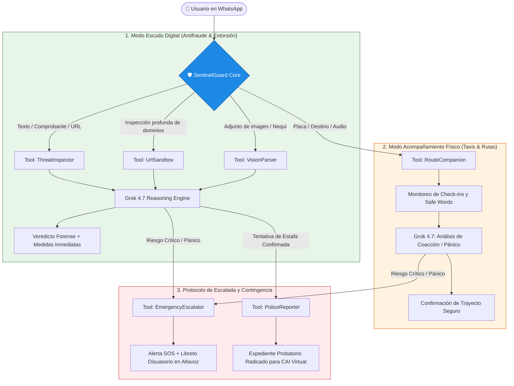

# 🛡️ SentinelGuard AI
### *El Guardaespaldas Autónomo Ciudadano (Digital & Físico)*

[](https://reto.pltk.mx/)
[-black.svg)](https://x.ai/)
[](#-equipo-codixia)
[-brightgreen.svg)](#-6-pruebas-y-calidad)
[](https://www.python.org/)

> **Protección integral 24/7 en WhatsApp: neutraliza estafas y extorsiones digitales con visión multimodal y cuida tu espalda en calles y taxis en tiempo real con monitoreo desatendido.**

---

## 👥 Equipo Codixia
*Ecosistema de Talento Campuslands · Reto Agente 2026 (Platica.mx × Campuslands)*

* **Fabián Aguilera** — *Lead Architect & Core Orchestrator* (Rol 1)
* **Miguel** — *Network & Threat Sandbox Specialist* (Rol 2)
* **Santiago** — *Seguridad Física, Rutas & Escalada* (Rol 3)
* **Nicolle** — *Social Engineering NLP, Visión & CAI Virtual* (Rol 4)
* **Juan José** — *Dataset Engineering, Stress Testing & UI* (Rol 5)

---

## 📌 1. El Problema Real

En Colombia y Latinoamérica, la delincuencia opera hoy en una intersección crítica entre lo **digital** y lo **físico**:

1. **Terrorismo Psicológico y Extorsión Digital**:
   - Más del **70% de los ciudadanos** han recibido mensajes o llamadas fraudulentas: suplantaciones de Nequi/Bancolombia, falsos premios, comparendos fantasma del SIMIT y extorsiones carcelarias amenazando a sus familias.
   - La gente pierde los ahorros de su vida o entra en pánico porque no tiene a quién consultar en los 30 segundos críticos de la llamada o el mensaje.

2. **Vulnerabilidad Física en Calles y Transporte Informal**:
   - Miedo constante al tomar un taxi de noche o caminar por calles desoladas en ciudades como Bogotá, Medellín, Bucaramanga o Cali.
   - Las apps tradicionales de mapas son pasivas: muestran una ruta, pero **no reaccionan si el vehículo se desvía por una trocha oscura** o si el pasajero está siendo amenazado en silencio.

**SentinelGuard AI** es el copiloto proactivo que interviene en segundos para proteger la vida y el patrimonio del ciudadano.

---

## 🏗️ 2. Arquitectura del Agente

SentinelGuard implementa un ciclo de vida autónomo: **Percibir → Ejecutar Tools → Razonar con Grok 4.7 → Decidir → Actuar**.



---

## ⚙️ 3. Las 5 Herramientas Reales (Tools Conectadas)

1. **`ThreatInspector`**: Extrae texto, analiza patrones de ingeniería social, detecta sesgos de urgencia artificial y clasifica amenazas (*Phishing Bancario*, *Extorsión Carcelaria*, *Falsa Oferta*, *SIMIT* o *Legítimo*).
2. **`UrlSandbox`**: Inspecciona enlaces, desenrolla acortadores (`bit.ly`, `tinyurl`) y analiza dominios con detección de *typosquatting* contra entidades financieras colombianas (`banc0lombia`, `nequii-pagos`) y protección perimetral SSRF.
3. **`VisionParser`**: Análisis forense multimodal para comprobantes de transferencia (Nequi, Bancolombia, Daviplata), cotejando metadatos para detectar falsificaciones digitales.
4. **`PoliceReporter`**: Genera expedientes probatorios estandarizados con radicado formal (`CAI-COL-XXXXXX`) listos para radicar ante el **CAI Virtual de la Policía Nacional de Colombia**.
5. **`RouteCompanion` & `EmergencyEscalator`**: Monitoreo de seguridad en transporte con sanitización de placas, intervalos de check-in, detección de palabras de auxilio/pánico (*safe words*) y despacho de escalada preventiva con guion disuasorio de audio.

---

## 🎯 4. Entregables Oficiales — Hito S2 (Semana 2)

| Requisito Oficial de S2 | Estado | Evidencia en el Repositorio |
| :--- | :---: | :--- |
| **3+ Herramientas Reales** | ✅ **Cumplido (5 tools)** | Conectadas y orquestadas en `src/agent/sentinel.py`. |
| **Tolerancia a Fallos y Manejo de Errores** | ✅ **Cumplido** | Fallback resiliente en cada tool; ante fallos de IA responde `risk_level: "NO_ANALIZADO"` sin falsos veredictos ni falsas denuncias. Blindaje de presupuesto a $0.00 en tests. |
| **10 Ejecuciones Reales Documentadas** | ✅ **Cumplido** | Ejecutadas con Grok 4.7. Bitácora completa en [`logs/s2_10_executions.md`](./logs/s2_10_executions.md) y [`logs/s2_10_executions.json`](./logs/s2_10_executions.json). Costo total: **$0.06289 USD**. |
| **Video Demo de 2 Minutos** | 🎥 **Cumplido (100%)** | [**Ver Video Demo Oficial (`video/SentinelGuard_AI_S2.mp4`)**](./video/SentinelGuard_AI_S2.mp4) *(Duración: ~2:00 min)* |

### 🎥 Enlace al Video Demo (2 minutos)
> 🎬 **Archivo en el Repositorio:** [`video/SentinelGuard_AI_S2.mp4`](./video/SentinelGuard_AI_S2.mp4)  
> 🔗 **Enlace Directo en GitHub:** [Ver video SentinelGuard_AI_S2.mp4 en GitHub](https://github.com/fcaguileraj7-camp/codixia-sentinel_reto/blob/main/video/SentinelGuard_AI_S2.mp4)  
> *Muestra en 2 minutos: Presentación del problema, detección de phishing bancario con radicado CAI Virtual, tolerancia a fallos, acompañamiento en taxi y suite de 74 pruebas en verde.*

---

## 🚀 5. Instalación y Ejecución Rápida

### Requisitos Previos
* **Python 3.10 o superior** (versiones verificadas al final de esta sección).
* Conexión a Internet para instalar las dependencias.
* Llave del Reto Agente (`pk_...`): **opcional**. Sin ella el agente corre en modo demo local (`mock`, costo $0).

### ⚡ Arranque de 1 Comando

Clona el repositorio, entra a la carpeta y ejecuta un solo comando. Prepara el entorno (`.venv` + `requirements.txt`), crea y verifica el `.env` y levanta el agente. Es idempotente: se puede repetir las veces que haga falta.

```bash
git clone https://github.com/fcaguileraj7-camp/codixia-sentinel_reto.git
cd codixia-sentinel_reto

# Windows (cmd o PowerShell)
.\run.bat

# Linux / macOS (si no tiene permiso de ejecución: bash run.sh)
./run.sh
```

| Comando | Qué hace |
| :--- | :--- |
| `run.bat` · `./run.sh` | Levanta la interfaz web (Streamlit) en `http://localhost:8501` |
| `... --cli` | Demostración por consola (`main.py`) |
| `... --test` | Suite de pruebas (`pytest`, red mockeada, costo $0) |
| `... --check` | Solo prepara y verifica el entorno, con una prueba de humo del agente en modo mock |
| `... --live` | Habilita llamadas reales a Grok. Exige una `RETO_API_KEY` con formato `pk_` (no se comprueba contra la API). No se combina con `--test` ni `--check` |

**Qué garantiza el script:**
* **Costos protegidos:** por defecto fuerza `GROK_MODE=mock` aunque tu `.env` diga `live`, y te lo avisa. Las llamadas reales a Grok gastan el saldo compartido del equipo y solo se activan con `--live`.
* **`.env`:** si falta, lo crea desde `.env.example`. Nunca lo sobrescribe ni muestra su contenido (tampoco la llave).
* **Streamlit local:** con `run.bat` / `run.sh` arranca en `localhost`, sin pedir correo en el primer arranque y sin enviar estadísticas de uso. Si lo lanzas a mano con `streamlit run`, esos ajustes no se aplican.
* **No destructivo:** nunca borra un `.venv` existente. Si es de otro sistema o está dañado, falla con un mensaje y lo decides tú.
* **Códigos de salida:** `0` correcto, `1` fallo de entorno, `2` argumentos inválidos. Con `--test`, `--cli` y la interfaz web el script devuelve el código del proceso que lanzó (por ejemplo, `pytest` usa `1` si hay pruebas fallidas y `2` si lo interrumpen).
* **Alcance del escudo de costos:** solo cubre lo que arranca `run.bat` / `run.sh`. Otros scripts (`scripts/`) no pasan por él y leen el `.env` tal cual. Además, `mock` significa sin costo de Grok, no sin red: el sandbox de URLs hace consultas HEAD reales a los enlaces que analiza.
* **`--check` no es de solo lectura:** crea `.venv`, instala dependencias y crea el `.env` si faltan, antes de la prueba de humo.
* **Flags:** se escriben en minúsculas, igual en ambos scripts (`--LIVE` se rechaza con código `2`).

**Problemas frecuentes:**
* *Windows, error `Long Path` al instalar:* clona el repositorio en una ruta corta, por ejemplo `C:\sentinel`.
* *Debian/Ubuntu, falta `python3-venv`:* `sudo apt install python3-venv` y vuelve a correr `./run.sh`.
* *No encuentra Python:* instala 3.10 o superior desde <https://www.python.org/downloads/>.

### Instalación Manual (alternativa)

1. **Clonar el repositorio**:
   ```bash
   git clone https://github.com/fcaguileraj7-camp/codixia-sentinel_reto.git
   cd codixia-sentinel_reto
   ```

2. **Crear y activar el entorno virtual**:
   ```bash
   python -m venv .venv
   # En Windows:
   .\.venv\Scripts\activate
   # En Linux/Mac:
   source .venv/bin/activate
   ```

3. **Instalar dependencias**:
   ```bash
   pip install -r requirements.txt
   ```

4. **Configurar las credenciales**:
   Copia el archivo de ejemplo y coloca tu llave asignada:
   ```bash
   cp .env.example .env
   ```
   Edita `.env`:
   ```env
   RETO_API_KEY=pk_tu_llave_asignada_aqui
   RETO_BASE_URL=https://api.reto.pltk.mx/v1
   GROK_MODEL=grok-4.7
   ```

5. **Ejecutar Demostración por Consola (CLI)**:
   ```bash
   python main.py
   ```

6. **Ejecutar Interfaz Gráfica Web (Streamlit)**:
   ```bash
   streamlit run app_streamlit.py
   ```

### ✅ Versiones Verificadas (2026-11-12)

Probado en una carpeta nueva (`git clone`), sin `.venv` ni `.env`, con `run.bat` / `run.sh`: `--check`, `--cli`, `--test` y arranque de Streamlit (salud `ok` en `/_stcore/health`).

| Entorno | Python | Resultado |
| :--- | :---: | :--- |
| Windows 10 · `run.bat` | 3.15.0 | ✅ `--check`, `--cli`, `--test` (517 tests) y Streamlit |
| Windows 10 · Git Bash · `run.sh --check` | 3.15.0 | ✅ |
| Linux · Docker `python:3.12-slim` · `run.sh` | 3.12.15 | ✅ `--check`, `--cli`, `--test` (517 tests) y Streamlit |
| Linux · Docker `python:3.10-slim` · `run.sh` | 3.10.22 | ✅ `--check`, `--cli`, `--test` (517 tests) y Streamlit |

No se probó en macOS. En Ubuntu 26.04 y Debian 13 (WSL) solo se comprobaron los mensajes de error cuando falta `python3-venv` o Python.

`requirements.txt` fija mínimos (`>=`) sin tope, así que una instalación futura puede traer versiones más nuevas. Esto es lo que se instaló en esas pruebas:

| Paquete | Windows · 3.15 | Linux · 3.12 | Linux · 3.10 |
| :--- | :---: | :---: | :---: |
| `openai` | 3.49.0 | 3.50.0 | 3.50.0 |
| `streamlit` | 1.67.0 | 1.67.0 | 1.65.0 |
| `pydantic` | 2.14.3 | 2.14.3 | 2.14.3 |
| `fastapi` | 0.162.5 | 0.162.5 | 0.162.5 |
| `uvicorn` | 0.54.0 | 0.54.0 | 0.54.0 |
| `pillow` | 13.0.0 | 13.0.0 | 12.3.0 |
| `python-dotenv` | 1.2.4 | 1.2.4 | 1.2.4 |
| `rich` | 15.0.0 | 15.0.0 | 15.0.0 |
| `requests` | 2.34.2 | 2.34.2 | 2.34.2 |
| `pytest` | 9.2.0 | 9.2.0 | 9.2.0 |

---

## 🧪 6. Pruebas y Calidad de Código

El proyecto cuenta con un blindaje estructural de presupuesto: **todas las pruebas unitarias y de integración corren en modo local determinista a costo $0.00 USD**:

```bash
python -m pytest tests/ -v
```

* **Resultado:** **74 tests pasando al 100% en verde** en ~6 segundos:
  * `tests/test_agent.py`: Ciclo autónomo, visión multimodal, tolerancia a fallos, blindaje de saldo y enrutamiento pericial SIMIT.
  * `tests/test_sandbox.py`: 29 pruebas exhaustivas de ciberseguridad en red (typosquatting por distancia de edición y leetspeak, desenrollado seguro de acortadores bit.ly/t.co, protección contra SSRF y redirecciones a redes privadas).
  * `tests/test_app_streamlit.py`: 21 pruebas completas de la interfaz web y estados de error.
  * `tests/test_route.py`: Monitoreo de trayectos, alertas de pánico y escalada SOS.
  * `tests/test_threat.py`: Reglas heurísticas y patrones de ingeniería social.
  * `tests/test_vision.py`: Radicado policial CAI Virtual y comprobantes.
  * `tests/test_performance.py`: Exactitud sobre el dataset de evaluación.

---

## 📅 7. Hoja de Ruta de los Hitos (Track 1)

* [x] **Semana 1 (S1) · Agente corriendo (Oct 5 - 11)**: Repositorio estructurado, cliente contra Grok funcional en `main.py` con llave oficial y simulación end-to-end.
* [x] **Semana 2 (S2) · Herramientas reales (Oct 12 - 24)**: Conexión de 5 herramientas reales, tolerancia a fallos sin falsos veredictos, 10 ejecuciones documentadas con Grok 4.7 ($0.06 USD), suite de 74 pruebas e interfaz Streamlit para video demo.
* [x] **Semana 3 (S3) · Datos reales (Oct 25 - 31)**: Evaluación de 40 casos periciales duales contra Grok 4.7 en vivo (97.5% de precisión, $0.337 USD), memoria multi-turno en `src/agent/memory.py` y telemetría de tokens real de `response.usage`. [Ver Reporte S3](docs/REPORTE_TECNICO_HITO_3.md).
* [x] **Semana 4 (S4) · Semana de carga (Nov 1 - 7)**: Procesamiento desatendido de 1.050 unidades en 12.6 horas continuas contra Grok 4.7 (100% de éxito, 0 caídas, ~$9.15 USD consumidos), bitácora pericial CSV/JSON, desacoplamiento total del taxi hacia ciberseguridad colombiana, servidor WhatsApp Webhook y suite de 517 tests. [Ver Reporte S4](docs/REPORTE_TECNICO_HITO_4.md).
* [ ] **Cierre Final & Pitch (Noviembre)**: Mentorías 1 a 1, pitch deck, video final y postulación a premiación.

> 📚 **Documentación técnica para el equipo y evaluadores:**
> - [Reporte Técnico Oficial de Entrega Hito S4 (docs/REPORTE_TECNICO_HITO_4.md)](docs/REPORTE_TECNICO_HITO_4.md)
> - [Bitácora Oficial de Carga CSV (data/bitacora_s4_carga.csv)](data/bitacora_s4_carga.csv)
> - [Reporte Técnico Oficial Hito S3 (docs/REPORTE_TECNICO_HITO_3.md)](docs/REPORTE_TECNICO_HITO_3.md)
> - [Guía de Integración WhatsApp Webhook (docs/GUIA_INTEGRACION_WHATSAPP.md)](docs/GUIA_INTEGRACION_WHATSAPP.md)
> - [Plan Maestro de Arquitectura y Roles (MASTER_PLAN_CODIXIA.md)](./MASTER_PLAN_CODIXIA.md)

---

## 📄 Licencia y Transparencia
Proyecto desarrollado para el **Reto Agente 2026** por el **Equipo Codixia**. Licencia abierta [MIT](./LICENSE).
