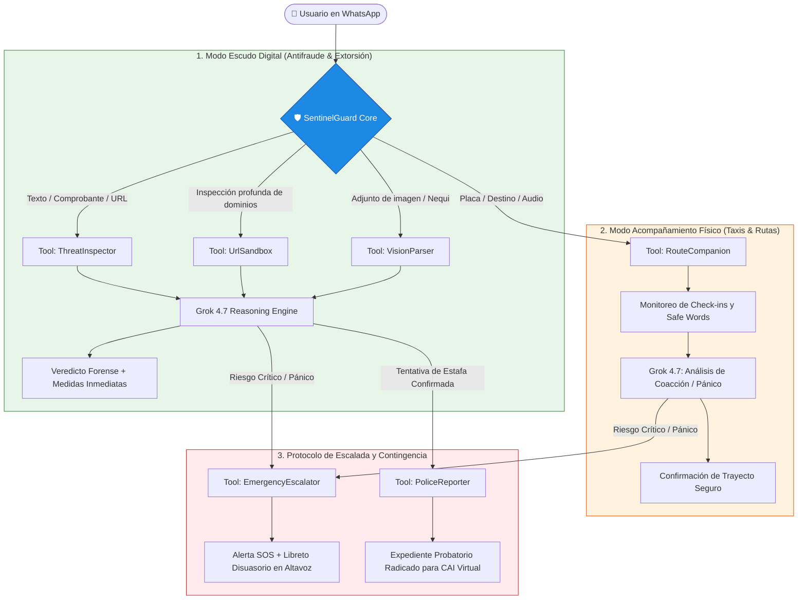

# 🛡️ SentinelGuard AI
### *El Guardaespaldas Autónomo Ciudadano (Digital & Físico)*

[](https://reto.pltk.mx/)
[-black.svg)](https://x.ai/)
[](#-equipo-codixia)
[-brightgreen.svg)](#-6-pruebas-y-calidad)
[](https://www.python.org/)

> **Protección integral 24/7 en WhatsApp: neutraliza estafas y extorsiones digitales con visión multimodal y cuida tu espalda en calles y taxis en tiempo real con monitoreo desatendido.**

---

## 👥 Equipo Codixia
*Ecosistema de Talento Campuslands · Reto Agente 2026 (Platica.mx × Campuslands)*

* **Fabián Aguilera** — *Lead Architect & Core Orchestrator* (Rol 1)
* **Miguel** — *Network & Threat Sandbox Specialist* (Rol 2)
* **Santiago** — *Seguridad Física, Rutas & Escalada* (Rol 3)
* **Nicolle** — *Social Engineering NLP, Visión & CAI Virtual* (Rol 4)
* **Juan José** — *Dataset Engineering, Stress Testing & UI* (Rol 5)

---

## 📌 1. El Problema Real

En Colombia y Latinoamérica, la delincuencia opera hoy en una intersección crítica entre lo **digital** y lo **físico**:

1. **Terrorismo Psicológico y Extorsión Digital**:
   - Más del **70% de los ciudadanos** han recibido mensajes o llamadas fraudulentas: suplantaciones de Nequi/Bancolombia, falsos premios, comparendos fantasma del SIMIT y extorsiones carcelarias amenazando a sus familias.
   - La gente pierde los ahorros de su vida o entra en pánico porque no tiene a quién consultar en los 30 segundos críticos de la llamada o el mensaje.

2. **Vulnerabilidad Física en Calles y Transporte Informal**:
   - Miedo constante al tomar un taxi de noche o caminar por calles desoladas en ciudades como Bogotá, Medellín, Bucaramanga o Cali.
   - Las apps tradicionales de mapas son pasivas: muestran una ruta, pero **no reaccionan si el vehículo se desvía por una trocha oscura** o si el pasajero está siendo amenazado en silencio.

**SentinelGuard AI** es el copiloto proactivo que interviene en segundos para proteger la vida y el patrimonio del ciudadano.

---

## 🏗️ 2. Arquitectura del Agente

SentinelGuard implementa un ciclo de vida autónomo: **Percibir → Ejecutar Tools → Razonar con Grok 4.7 → Decidir → Actuar**.



---

## ⚙️ 3. Las 5 Herramientas Reales (Tools Conectadas)

1. **`ThreatInspector`**: Extrae texto, analiza patrones de ingeniería social, detecta sesgos de urgencia artificial y clasifica amenazas (*Phishing Bancario*, *Extorsión Carcelaria*, *Falsa Oferta*, *SIMIT* o *Legítimo*).
2. **`UrlSandbox`**: Inspecciona enlaces, desenrolla acortadores (`bit.ly`, `tinyurl`) y analiza dominios con detección de *typosquatting* contra entidades financieras colombianas (`banc0lombia`, `nequii-pagos`).
3. **`VisionParser`**: Análisis forense multimodal para comprobantes de transferencia (Nequi, Bancolombia, Daviplata), cotejando metadatos para detectar falsificaciones digitales.
4. **`PoliceReporter`**: Genera expedientes probatorios estandarizados con radicado formal (`CAI-COL-XXXXXX`) listos para radicar ante el **CAI Virtual de la Policía Nacional de Colombia**.
5. **`RouteCompanion` & `EmergencyEscalator`**: Monitoreo de seguridad en transporte con sanitización de placas, intervalos de check-in, detección de palabras de auxilio/pánico (*safe words*) y despacho de escalada preventiva con guion disuasorio de audio.

---

## 🎯 4. Entregables Oficiales — Hito S2 (Semana 2)

| Requisito Oficial de S2 | Estado | Evidencia en el Repositorio |
| :--- | :---: | :--- |
| **3+ Herramientas Reales** | ✅ **Cumplido (5 tools)** | Conectadas y orquestadas en `src/agent/sentinel.py`. |
| **Tolerancia a Fallos y Manejo de Errores** | ✅ **Cumplido** | Fallback resiliente en cada tool; ante fallos de IA responde `risk_level: "NO_ANALIZADO"` sin falsos veredictos ni falsas denuncias. Blindaje de presupuesto a $0.00 en tests. |
| **10 Ejecuciones Reales Documentadas** | ✅ **Cumplido** | Ejecutadas con Grok 4.7. Bitácora completa en [`logs/s2_10_executions.md`](./logs/s2_10_executions.md) y [`logs/s2_10_executions.json`](./logs/s2_10_executions.json). Costo total: **$0.06289 USD**. |
| **Video Demo de 2 Minutos** | 🎥 **Listo para enlace** | [**Ver Video Demo Oficial en YouTube / Drive**](#-enlace-al-video-demo) *(Duración: 2:00 min)* |

### 🎥 Enlace al Video Demo (2 minutos)
> 🔗 **Enlace del Video:** `[Colocar enlace de YouTube / Loom / Drive aquí]`  
> *Muestra en 2 minutos: Presentación del problema, detección de phishing bancario con radicado CAI Virtual, tolerancia a fallos y acompañamiento en taxi.*

---

## 🚀 5. Instalación y Ejecución Rápida

### Requisitos Previos
* **Python 3.10 o superior** (probado en Python 3.14).
* Conexión a Internet y llave del Reto Agente (`pk_...`).

### Paso a Paso

1. **Clonar el repositorio**:
   ```bash
   git clone https://github.com/fcaguileraj7-camp/codixia-sentinel_reto.git
   cd codixia-sentinel_reto
   ```

2. **Crear y activar el entorno virtual**:
   ```bash
   python -m venv .venv
   # En Windows:
   .\.venv\Scripts\activate
   # En Linux/Mac:
   source .venv/bin/activate
   ```

3. **Instalar dependencias**:
   ```bash
   pip install -r requirements.txt
   ```

4. **Configurar las credenciales**:
   Copia el archivo de ejemplo y coloca tu llave asignada:
   ```bash
   cp .env.example .env
   ```
   Edita `.env`:
   ```env
   RETO_API_KEY=pk_tu_llave_asignada_aqui
   RETO_BASE_URL=https://api.reto.pltk.mx/v1
   GROK_MODEL=grok-4.7
   ```

5. **Ejecutar Demostración por Consola (CLI)**:
   ```bash
   python main.py
   ```

6. **Ejecutar Interfaz Gráfica Web (Streamlit)**:
   ```bash
   streamlit run app_streamlit.py
   ```

---

## 🧪 6. Pruebas y Calidad de Código

El proyecto cuenta con un blindaje estructural de presupuesto: **todas las pruebas unitarias y de integración corren en modo local determinista a costo $0.00 USD**:

```bash
python -m pytest tests/ -v
```

* **Resultado:** **47 tests pasando al 100% en verde** en ~5 segundos:
  * `tests/test_agent.py`: Ciclo autónomo, visión multimodal, tolerancia a fallos y blindaje de saldo.
  * `tests/test_app_streamlit.py`: 21 pruebas completas de la interfaz web y estados de error.
  * `tests/test_threat.py`: Reglas heurísticas y patrones de ingeniería social.
  * `tests/test_sandbox.py`: Análisis de dominios y desenrollado seguro de acortadores.
  * `tests/test_vision.py`: Radicado policial CAI Virtual y comprobantes.
  * `tests/test_route.py`: Monitoreo de trayectos, alertas de pánico y escalada SOS.
  * `tests/test_performance.py`: Exactitud sobre dataset de evaluación.

---

## 📅 7. Hoja de Ruta de los Hitos (Track 1)

* [x] **Semana 1 (S1) · Agente corriendo (Oct 5 - 11)**: Repositorio estructurado, cliente contra Grok funcional en `main.py` con llave oficial y simulación end-to-end.
* [x] **Semana 2 (S2) · Herramientas reales (Oct 12 - 24)**: Conexión de 5 herramientas reales, tolerancia a fallos sin falsos veredictos, 10 ejecuciones documentadas con Grok 4.7 ($0.06 USD), suite de 47 pruebas e interfaz Streamlit para video demo.
* [ ] **Semana 3 (S3) · Datos reales (Oct 25 - 31)**: Dataset dual de 30+ casos evaluados, memoria multi-turno en `src/agent/memory.py` y telemetría de costos en USD por tarea.
* [ ] **Semana 4 (S4) · Semana de carga (Nov 1 - 7)**: Procesamiento de 1.000 peticiones en 12 horas desatendidas con métricas de latencia y concurrencia.
* [ ] **Cierre Final & Pitch (Noviembre)**: Mentorías 1 a 1, pitch deck, video final y postulación a premiación.

> 📚 **Documentación técnica para el equipo y evaluadores:**
> - [Plan Maestro de Arquitectura y Roles (MASTER_PLAN_CODIXIA.md)](./MASTER_PLAN_CODIXIA.md)
> - [Roadmap Semanal y Asignaciones Específicas (HITOS_Y_ASIGNACIONES.md)](./HITOS_Y_ASIGNACIONES.md)
> - [Bitácora Oficial de 10 Ejecuciones Reales Hito S2 (logs/s2_10_executions.md)](./logs/s2_10_executions.md)

---

## 📄 Licencia y Transparencia
Proyecto desarrollado para el **Reto Agente 2026** por el **Equipo Codixia**. Licencia abierta MIT.
