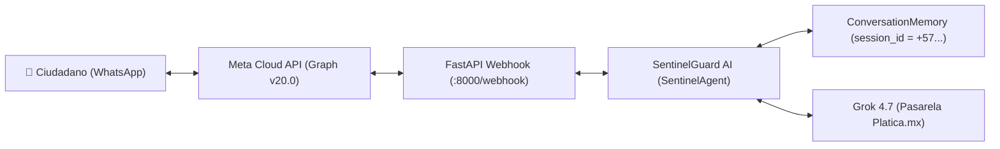

# 📱 Guía Oficial de Integración: SentinelGuard AI × WhatsApp Cloud API

**Reto Agente 2026** · Platica.mx × Campuslands  
**Equipo:** Codixia  

SentinelGuard AI cuenta con una pasarela FastAPI nativa ([`src/interfaces/whatsapp.py`](../src/interfaces/whatsapp.py)) para operar como un bot de WhatsApp ciudadano con **memoria conversacional multi-turno aislada por número de teléfono**.

---

## 🏗️ Arquitectura del Webhook



1. **Aislamiento por Teléfono:** Cada número de WhatsApp actúa como un `session_id` único en [`ConversationMemory`](../src/agent/memory.py).
2. **Formato Optimizado:** Las respuestas devuelven veredictos claros, emojis periciales, advertencias de riesgo y el número de expediente preventivo ante el **CAI Virtual** (`CAI-COL-...`).
3. **Doble Modo:** Opera en modo local simulado ($0.00 USD) o conectado a la API de Meta en vivo.

---

## 🧪 Opción 1: Prueba Local / Simulación Inmediata ($0.00 USD)

No necesitas credenciales de Meta ni cuenta de desarrollador para probar el flujo completo:

### Paso 1: Levantar el servidor webhook
```powershell
.\.venv\Scripts\python.exe scripts/run_whatsapp_server.py --port 8000
```

### Paso 2: En otra terminal, ejecutar la demo interactiva
```powershell
.\.venv\Scripts\python.exe scripts/demo_whatsapp_chat.py
```

El script simulará automáticamente:
- **Handshake de verificación de Meta** (`GET /webhook`).
- **Turno 1:** Mensaje de smishing bancario de Bancolombia.
- **Turno 2:** Pregunta de seguimiento sobre entregar códigos SMS (demostrando memoria de contexto).
- **Turno 3:** Consulta general de ciberseguridad.

---

## 🌐 Opción 2: Conexión Real con Meta WhatsApp Sandbox (En Vivo)

Para recibir y contestar mensajes reales desde tu propio teléfono:

### Paso 1: Exponer el puerto 8000 a Internet (Túnel)
Usa [ngrok](https://ngrok.com/) o Cloudflare Tunnel:
```powershell
ngrok http 8000
```
Copia la URL pública generada (ejemplo: `https://a1b2-c3d4.ngrok-free.app`).

### Paso 2: Configurar el Webhook en Meta Developers
1. Entra a [Meta for Developers](https://developers.facebook.com/) y entra a tu App.
2. Ve a **WhatsApp** → **Configuration** → **Webhook**:
   - **Callback URL:** `https://tu-url-ngrok.ngrok-free.app/webhook`
   - **Verify Token:** `sentinelguard_verify_2026` (o el que definas en `WHATSAPP_VERIFY_TOKEN`).
3. Haz clic en **Verify and Save**. Meta enviará un handshake `GET` y quedará verificado en verde.
4. En **Webhook fields**, suscríbete al evento `messages`.

### Paso 3: Configurar Credenciales en `.env`
En tu archivo `.env` local:
```ini
WHATSAPP_VERIFY_TOKEN=sentinelguard_verify_2026
WHATSAPP_ACCESS_TOKEN=EAAxxxx...   # Token temporal o de sistema generado en Meta
WHATSAPP_PHONE_NUMBER_ID=1234567890 # Phone number ID del remitente de pruebas
WHATSAPP_API_VERSION=v20.0
```

### Paso 4: Levantar el Servidor
```powershell
.\.venv\Scripts\python.exe scripts/run_whatsapp_server.py --port 8000
```

¡Listo! Cuando le escribas un mensaje o envíes una imagen al número de WhatsApp de pruebas, **SentinelGuard AI te responderá automáticamente**.
