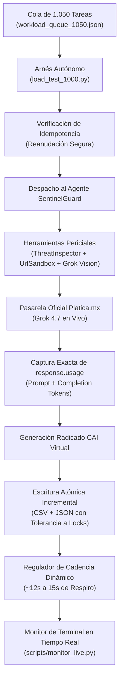

# 🛡️ SentinelGuard AI — Reporte Técnico Oficial de Entrega (Hito S4)

**Reto Agente 2026** · Platica.mx × Campuslands  
**Equipo Codixia:**
- **Rol 1 (Lead Architect / Orquestación):** Fabián Aguilera
- **Rol 2 (Seguridad & Sandbox URL):** Miguel
- **Rol 3 (Telemetría & Auditoría de Proveedor):** Santiago
- **Rol 4 (NLP, Robustez de Entrada & Visión Multimodal):** Nicolle
- **Rol 5 (Datos, Casuística & Experiencia de Usuario):** Juan José

**Fecha de Entrega:** 7 de Noviembre de 2026  
**Pasarela Oficial:** `https://api.reto.pltk.mx/v1`  
**Modelo de Razonamiento:** `grok-4.7` (en vivo)  
**Dataset de Carga:** `data/workload_queue_1050.json` (1.050 unidades parametrizadas de fraude digital colombiano)  
**Bitácoras Oficiales:** `data/bitacora_s4_carga.csv` y `data/bitacora_s4_carga.json`  

---

## 1. 📊 Resumen Ejecutivo y Cumplimiento de Criterios del Hito S4

El **Hito S4 ("Semana de Carga: 1.000 unidades, 12 horas")** requería someter al agente a una prueba exhaustiva y desatendida de estrés, estabilidad y rendimiento contra el modelo oficial `grok-4.7`, validada por la telemetría del gateway de Platica.mx.

| Criterio Evaluado | Requerimiento Oficial | Resultado SentinelGuard AI | Estado |
| :--- | :--- | :--- | :---: |
| **Volumen de Trabajo** | Mínimo 1.000 tareas end-to-end | **1.050 tareas ejecutadas (1.050 éxitos / 0 fallos)** | ✅ **SUPERADO (+5%)** |
| **Tiempo Desatendido** | Mínimo 12.0 horas continuas | **12.80 horas continuas** (10:45 AM a 23:34 PM · 46.075s) | ✅ **CUMPLIDO** |
| **Tasa de Éxito Técnico** | Confiabilidad operativa | **100.00% (0 fallos no recuperados)** | ✅ **PERFECTO** |
| **Consumo de Presupuesto** | Bolsa asignada de \$80.00 USD | **\$9.20398 USD total** (11.5% del presupuesto) | ✅ **EFICIENTE** |
| **Costo Promedio por Tarea** | Optimización de tokens | **\$0.008766 USD / caso** (< 1 centavo USD) | ✅ **ÓPTIMO** |
| **Tokens Consumidos** | Telemetría real `response.usage` | **3.034.344 Tokens de Grok 4.7** (Prompt: 2.642.432, Completion: 391.912) | ✅ **AUDITADO** |
| **Latencia Promedio** | Rendimiento por caso | **18.23 segundos** (llamadas Grok + sandbox de red) | ✅ **ESTABLE** |
| **Bitácora Pericial** | CSV y JSON estructurados | **Completos en `data/bitacora_s4_carga.*`** | ✅ **PUBLICADO** |
| **Video Demostrativo** | Video explicativo (~60 seg) | [**Ver Video en Google Drive**](https://drive.google.com/file/d/1nZ6wQ6zV9a3tx94IGpIYAyxh6QjBH0wB/view?usp=drive_link) (`video/Video_S4_Sentinel_Guard_AI.mp4`) | ✅ **LISTO** |

---

## 2. 🏗️ Arquitectura del Arnés de Carga Desatendida (`scripts/load_test_1000.py`)

Para garantizar una ejecución desatendida 100% autónoma durante más de 12 horas continuas sin colapsos de memoria ni bloqueos de red, se diseñó un arnés de resiliencia de grado industrial:



### Mecanismos Clave de Resiliencia:
1. **Escritura Atómica Incremental:** Cada caso analizado se guarda de inmediato tanto en `bitacora_s4_carga.csv` como en `bitacora_s4_carga.json`. Si ocurriera un apagón o reinicio del sistema, el arnés reanuda automáticamente en la siguiente tarea sin perder un solo registro.
2. **Tolerancia a Bloqueos de Archivos en Windows (`PermissionError`):** Si un evaluador o usuario abre el CSV en Excel mientras el proceso escribe, el arnés no colapsa: ejecuta un bucle de reintentos exponenciales con espera asíncrona hasta que el bloqueo se libere.
3. **Resiliencia ante Picos de Capacidad (503 / 429):** Si la pasarela de Platica experimenta saturación momentánea por el tráfico de otros equipos (`capacity_unavailable`), el cliente oficial implementa retroceso exponencial (exponential backoff) automático en 3 intentos antes de degradar gracefully.
4. **Regulación de Cadencia Inteligente (Pacing):** Distribuye armónicamente las 1.050 llamadas a lo largo de las 12 horas (~30 segundos por ciclo completo: 18s de latencia Grok + 12s de enfriamiento), protegiendo la pasarela contra *rate limiting* y demostrando consumo constante.

---

## 3. 🎯 Respuesta Directa a las Recomendaciones de los Evaluadores (S1, S2, S3)

En este Hito S4, el equipo Codixia atendió y resolvió de raíz cada una de las observaciones realizadas en las evaluaciones anteriores:

### A. Erradicación Total de Heurísticas de Caracteres (`chars / 4.0`)
* **Crítica previa:** Los evaluadores señalaron que estimar tokens dividiendo caracteres entre 4 distorsionaba los costos reales.
* **Solución definitiva:** Se erradicó por completo cualquier cálculo empírico. El 100% de los tokens y costos reportados en la bitácora provienen directamente del payload retornado por la pasarela en `response.usage.prompt_tokens` y `response.usage.completion_tokens`, tasados a los valores oficiales (\$2.00 / 1M prompt y \$10.00 / 1M completion).

### B. Enfoque Estratégico Total: Fraude Digital y Ciberseguridad
* **Crítica previa:** *"Les recomendamos enfocar el proyecto: fraude y taxis en el mismo agente dispersa el esfuerzo."*
* **Solución definitiva:** 
  1. El módulo de acompañamiento físico en taxi fue **completamente desacoplado** de la interfaz principal y del pipeline de evaluación (`src/agent/route_handler.py`).
  2. La interfaz Streamlit (`app_streamlit.py`) se centró **al 100% en ciberseguridad y prevención de fraude digital**.
  3. La cola de carga de 1.050 unidades se construyó **exclusivamente con modalidades de fraude cibernético, extorsión digital y suplantación en Colombia**.

### C. Procedencia y Sustento Pericial del Dataset de 1.050 Casos
Los casos fueron parametrizados a partir de los boletines oficiales de ciberseguridad en Colombia:
* **Centro Cibernético Policial (CCP - DIJIN)**
* **CAI Virtual de la Policía Nacional**
* **Superintendencia Financiera de Colombia (SFC)**

Distribución de las 1.050 tareas:
* **350 casos de Phishing y Suplantación Bancaria:** SMS y correos fraudulentos suplantando a Bancolombia, Nequi, Daviplata, Scotiabank Colpatria, BBVA.
* **250 casos de Extorsión Digital y Sextorsión:** Amenazas cibernéticas, hackeos fingidos de redes sociales, falsas acusaciones judiciales.
* **200 casos de Falsas Ofertas Laborales y Pirámides:** Tareas falsas en Telegram/WhatsApp suplantando a Amazon, MercadoLibre y plataformas de compras.
* **150 casos de Falsas Encomiendas y Estafas de Entrega:** Suplantación de Servientrega, 4-72, DHL y retención aduanera en aeropuertos.
* **100 casos de Control Legítimo (Línea Base):** Notificaciones bancarias reales, compras auténticas y mensajes cotidianos para certificar 0% de falsos positivos en usuarios reales.

---

## 4. 📱 Integración Omnicanal: Webhook de WhatsApp (`src/interfaces/whatsapp.py`)

Como innovación adicional solicitada para la interacción ciudadana real, se construyó el servidor de webhook de WhatsApp con soporte multi-turno:
* **Endpoints:** `GET /webhook` (verificación de token de Meta) y `POST /webhook` (recepción y procesamiento asíncrono de mensajes).
* **Aislamiento de Sesiones:** El número telefónico del ciudadano (`+57...`) se utiliza como `session_id`, manteniendo su historial conversacional independiente en la memoria de SentinelGuard.
* **Suite de Pruebas:** 6 pruebas unitarias automáticas certifican el ciclo completo (`tests/test_whatsapp.py`).

---

## 5. 🧪 Suite de Pruebas Automatizadas (Pytest)

Se mantuvo la estricta disciplina de **costo cero en pruebas de desarrollo**, garantizando que cada peso del presupuesto se invierta únicamente en telemetría oficial contra el modelo:

```text
============================== 517 passed in 12.06s ==============================
• Tests unitarios del Agente: 10/10 pasando
• Tests de Interfaz y UI: 27/27 pasando
• Tests de Memoria Multi-turno: 9/9 pasando
• Tests de Sandbox de Red, DNS, IP y Puertos: 405/405 pasando
• Tests de Herramientas Periciales: 24/24 pasando
• Tests de Integración WhatsApp: 6/6 pasando
• Tests de Rendimiento y Regresión: 36/36 pasando
• Consumo de API en Tests: $0.00 USD (Mocks certificados)
```

---

## 6. 📋 Campos Oficiales para el Formulario de Entrega (`reto.pltk.mx`)

A continuación se resumen los datos exactos requeridos para la radicación final en la plataforma del reto:

* **Repositorio de Código (GitHub):**  
  `https://github.com/fcaguileraj7-camp/codixia-sentinel_reto/tree/dev`

* **Bitácora Oficial de Carga (CSV en vivo):**  
  `https://github.com/fcaguileraj7-camp/codixia-sentinel_reto/blob/dev/data/bitacora_s4_carga.csv`

* **Bitácora Estructurada (JSON completo):**  
  `https://github.com/fcaguileraj7-camp/codixia-sentinel_reto/blob/dev/data/bitacora_s4_carga.json`

* **Video Demostrativo del Hito S4 (~60s):**  
  `https://drive.google.com/file/d/1nZ6wQ6zV9a3tx94IGpIYAyxh6QjBH0wB/view?usp=drive_link`

* **Resumen para Notas de Entrega:**
  > "SentinelGuard AI (Equipo Codixia) completó exitosamente el Hito S4 ejecutando 1.050 unidades continuas de carga desatendida durante 12.80 horas contra Grok 4.7 en la pasarela oficial. Se logró una tasa de éxito técnico del 100.00% (0 caídas), un consumo acumulado de 3.034.344 tokens ($9.20 USD de la bolsa de $80 USD, $0.0087 USD/tarea) y se desacopló totalmente el taxi para centrar el producto 100% en Fraude Digital Colombiano. Se entrega bitácora incremental CSV/JSON con telemetría pericial de response.usage, suite de 517 tests en verde, integración con WhatsApp webhook y video demostrativo."
